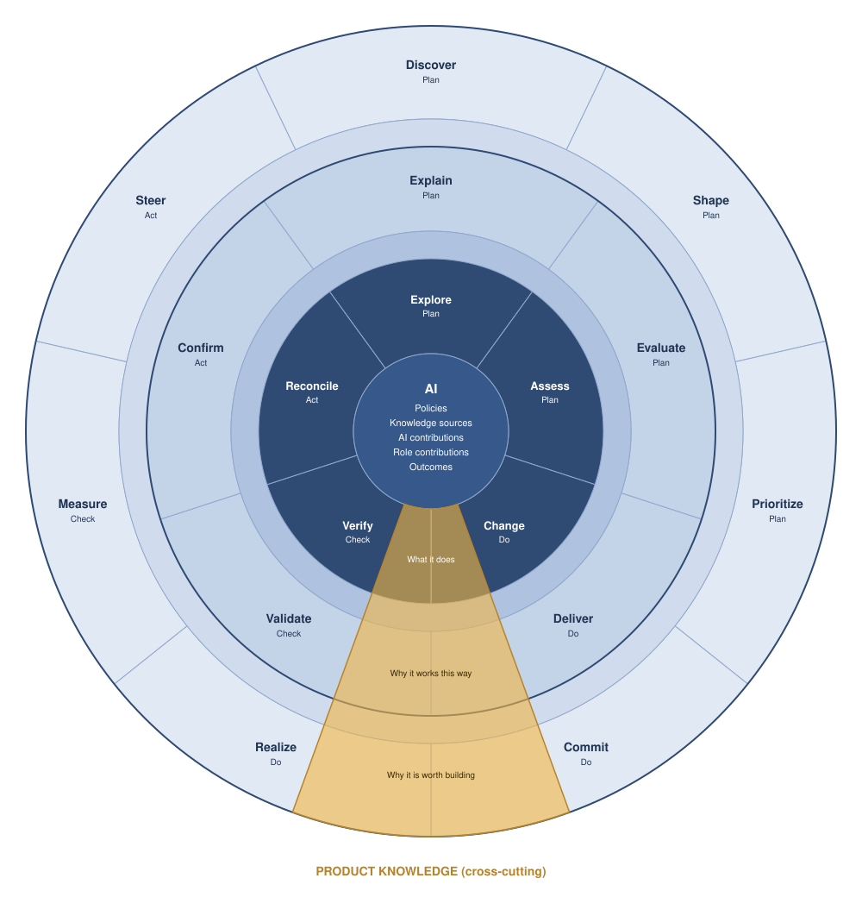

# Chapter 1: Layers

The development model has three concentric layers. Each layer wraps the one inside it and constrains it. Everything is built around AI.

## 1.1 The three layers

**[Value](04-value-layer.md).** Treats the product as a business entity that generates value over its lifecycle. Faces the organization, the market, and the users. Decides what is worth doing, how much risk is acceptable, when to stop or retire, and who is accountable for the result. Value here covers cost and risk as well as gain; it is not a value stream in the sense of a delivery flow.

**[Delivery](03-delivery-layer.md).** The translation layer. It maps business terms to technical terms per domain, per product feature, and for cross-cutting concerns such as technical debt, security, deployment, and infrastructure. The mapping runs in both directions: business intent is explained to the technical side, and technical reality is explained to the business side. Delivery knowledge is owned by the Agentic Engineer for its technical half and by the Product Manager for its business half. Where AI drafts it, its owner confirms it.

**[AI](02-ai-layer.md).** Where almost all the work is done. The AI is fast and cheap, but non-deterministic, limited to the context it is given, and unable to be accountable.

## 1.2 The role of AI in each layer

In the core, the AI is the **actor**: it does the work.

In the outer layers, the AI is an **instrument** of the humans who own the layer. It prepares evidence, drafts, and challenges. Decisions and accountability stay with people.

Any AI used in the Delivery and Value layers must be independent of the AI doing the work in the core. Otherwise the system ends up judging itself.

## 1.3 Contracts and behavior

Each layer works through two kinds of things:

- **Contracts** between neighboring layers: Value and Delivery, and Delivery and AI. A contract defines how two layers communicate in all cases: what is requested inward, what is returned outward, and what happens when the inner layer cannot deliver. Contracts change only deliberately, based on the layer's outcomes, and are known to everyone who relies on them before they change.
- **Behavior** inside each layer: how the layer plays its part so the product gets built.

Contracts are designed from the core outward. We first define what the AI needs to do reliable work and what it must return to be trusted. Delivery is shaped by that, and Value by what Delivery needs.

AI used as an instrument inside a layer belongs to that layer's behavior, not to the contracts.

## 1.4 Product knowledge: a cross-cutting concern

Product knowledge is one body of knowledge that runs through all three layers. Each layer holds it at a different level of abstraction. The outer levels are written for humans and the business. The inner levels are more technical and written for AI.

| Layer | Level of knowledge | Example sources |
|---|---|---|
| [Value](04-value-layer.md#43-knowledge-sources) | Why the product is worth building | Strategy, customer evidence, market, business data |
| [Delivery](03-delivery-layer.md#33-knowledge-sources) | Why the product works the way it does | Business-to-technical mapping per domain and feature, cross-cutting concerns |
| [AI](02-ai-layer.md#23-knowledge-sources) | What the product does | Code, PR comments, commit messages, static analysis reports |

At both edges the model touches the product. The AI layer touches the product as it is built. The Value layer touches the product as it is experienced. Neither can be used raw: code repeats its own bad patterns, and feedback is noisy and late.

### 1.4.1 Consistency

The knowledge must be consistent across all levels. The code is explained by Delivery knowledge, and Delivery knowledge is justified by Value.

A gap between levels is a signal:

- Code that Delivery cannot explain: undocumented behavior or a bug.
- A feature that Value cannot justify: waste, or a candidate for retirement.
- A Value claim that Delivery and the code do not support: a false commitment.

Improving knowledge means finding and closing these gaps, not only writing more of it.

### 1.4.2 Sources of truth

Each kind of fact has exactly one source of truth across the whole framework. When another source disagrees with it, the other source is corrected.

| Kind of fact | Source of truth | Owning layer |
|---|---|---|
| What the product does | The code | AI |
| What the product should do | The committed intent and its specs | Delivery |
| Why it works this way | Recorded decisions | Delivery |
| What was delivered to whom | Delivery records | Delivery |
| How it is used | Usage data | Delivery |
| Why it is worth building | Value decisions | Value |

The code is the truth for what the product is; the intent and its specs are the truth for what it should be. When they disagree, either the code departs from what it should be, which is a bug, or knowledge departs from what the product is, which is stale knowledge.

## 1.5 Two kinds of maturity

The model uses two separate kinds of maturity. They answer different questions and must not be confused.

**Lifecycle stage** is the maturity of the product, a domain, or a feature: new idea, in development, mature, or retiring. It answers: *what does this work demand?* A new idea calls for fast, cheap learning. A feature in development calls for building towards completeness. A mature feature calls for preserving what already works. A retiring feature calls for removing it without breaking what still depends on it.

**Adoption maturity** is how far this model has been adopted in a layer of a given product. It answers: *how ready is this layer to carry its part?* It covers four dimensions: the layer's knowledge, implementation, roles, and outcomes. Its levels and how they are assessed are defined in [the Maturity chapter (Chapter 5)](05-maturity.md).

Adoption maturity is measured per layer, not per product. A product can have strong Value and a weak AI layer, or the reverse. This is what lets the model be applied to any product, including an existing product with poor knowledge: each layer works at its current level instead of the product having to be ready first.

The two combine. A mature part of the product in a layer with low adoption maturity is the riskiest combination: the work must preserve behavior that the layer does not yet fully understand.

Maturity adapts only the elements of a layer it actually affects. It does not apply to every element.

## 1.6 Running the layers

Layers do not run themselves; roles run them: the [Product Manager](roles/07-product-manager.md), the [Agentic Engineer](roles/08-agentic-engineer.md), and the [AI Enablement Lead](roles/09-ai-enablement-lead.md). When something fails, such as a failed validation, it is handled by the judgment of whoever runs the layer, not by a mechanism inside the layer.

## 1.7 Principles

Principles are what the framework stands on. They apply to every layer, every behavior, and every adoption of the framework, and they are never tailored: work that does not follow them is not done under this framework. Everything else, including contracts, behaviors, policies, and their implementation, is adopted and adapted to the product.

A principle is not checked directly. It shows in the policies and behaviors that realize it.

### 1.7.1 Accountability
**People are accountable; AI never is.** Every decision has one accountable person. The AI prepares, does, and challenges work, but never takes a decision that belongs to a person.

### 1.7.2 Independence
**No one judges their own work.** Verification is independent of whoever produced the work, whether a person or an AI.

### 1.7.3 Honesty
**Uncertainty is stated, never filled with assumptions.** "Could not be determined" is a valid answer; a confident guess is not.

### 1.7.4 Knowledge outside the model
**Knowledge lives outside the model.** Everything the AI needs and everything it produces exists outside the model, where its layer records it. Nothing depends on what a model or a session remembers, so models can be replaced.

### 1.7.5 Given context
**Context is given, never inferred.** The AI works on the context it receives: the request, its boundary, and the lifecycle stage and adoption maturity of what it concerns. What is not given is asked for, not assumed.

### 1.7.6 Shared, not personal
**AI contributions are shared, not personal.** A contribution is the same whoever asks for it. Personal prompts, habits, preferences, and tool defaults are not a channel for work.

### 1.7.7 Adaptation
**Adapt to lifecycle stage and adoption maturity.** How a layer works, and how much autonomy the AI is given, follow the stakes of the work and how ready the layer is to carry it. The principles themselves are never adapted.

## 1.8 Framework policies

Policies turn principles into what must or must not be done. Each policy realizes a principle of this framework, or an external principle the organization is bound by, such as information security or privacy. The principle a policy realizes is cited with it.

Framework policies apply to every layer. A layer may make a framework policy stricter or give it a concrete interpretation, but never make it looser. Each layer adds its own policies in its chapter.

### 1.8.1 Authority
- A layer acts only within its purpose and on requests that come through its contracts. ([1.7.5](#175-given-context))
- A layer never fills gaps with assumptions. When intent is unclear, conflicts with reality, or would cross a boundary, it stops and asks. ([1.7.3](#173-honesty))
- A layer acts only within the boundary it was given. What it notices outside that boundary, it reports. ([1.7.5](#175-given-context))

### 1.8.2 Autonomy
- Autonomy is lowest where the stakes are highest and understanding is lowest: mature parts with low adoption maturity. ([1.7.7](#177-adaptation))
- Work touching a sensitive area is never fully autonomous, at any stage or maturity. ([1.7.1](#171-accountability))
- Autonomy can be tightened for a single request, but never loosened beyond the layer's interpretation. ([1.7.7](#177-adaptation))

### 1.8.3 Trace
- Every AI contribution leaves a trace with its output: what it served, the adaptation parameters, the skill version, the model used, and, where a person confirms the result, who confirmed it. ([1.7.1](#171-accountability), [1.7.4](#174-knowledge-outside-the-model))

### 1.8.4 Data protection
- No personal data, secrets, or credentials enter the context of any AI, in any layer. (External: information security and privacy, see [Appendix A.4](appendix-a-alignment.md#a4-principles-and-policies))

## 1.9 What defines each layer

Each layer is described by the same elements:

| Element | Question |
|---|---|
| Purpose | The layer's main duties: what would be lost without the layer, which no other layer can take over |
| Contracts | How it communicates with its neighboring layers in all cases |
| Knowledge sources | What product knowledge it owns, keeps alive, and learns from |
| Policies | The rules the layer must follow, including what it must never do, each realizing a principle or an external principle |
| Behavior | How the layer is expected to act, for each contract it serves or, where it owns no contracts, for each of its activities |
| AI contributions | How AI is used in this layer, as actor or as instrument, and how that use is materialized |
| Role contributions | What each role is responsible for in this layer |
| Outcomes | What the layer has actually achieved over time against its purpose. Outputs of an individual request, including proof of change, are not part of this element. |
| Adaptation | How lifecycle stage and adoption maturity change the layer. Stated within each element where it applies. |

## 1.10 Model

- **Rings:** Value (outer), Delivery (middle), AI (core).
- **[Value layer](04-value-layer.md#45-behavior):** the seven behaviors as slices around a band naming the components of the layer.
- **[Delivery layer](03-delivery-layer.md#35-behavior):** the five behaviors as slices around a band naming the components of the layer.
- **[AI layer](02-ai-layer.md#25-behavior):** the five behaviors as slices around a core naming the components of the layer.
- Each Delivery behavior sits directly outside its AI counterpart: Explain and Explore, Evaluate and Assess, Deliver and Change, Validate and Verify, Confirm and Reconcile.
- **[Product knowledge](#14-product-knowledge-a-cross-cutting-concern):** the cross-cutting slice through all layers, at a different level of abstraction in each: what the product does (AI), why it works this way (Delivery), and why it is worth building (Value).
- **[Alignment with PDCA](appendix-a-alignment.md#a2-pdca):** every layer follows the Plan-Do-Check-Act cycle through its behaviors.
